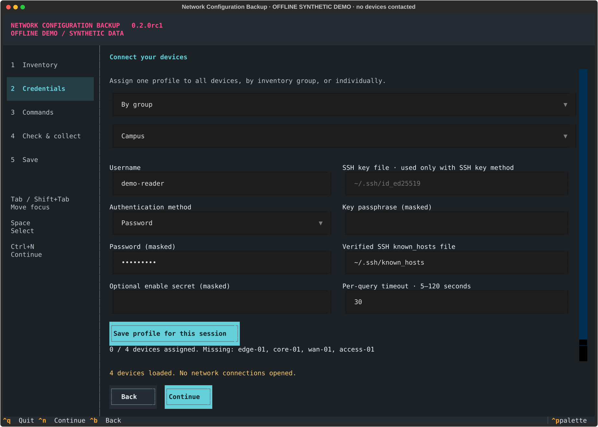
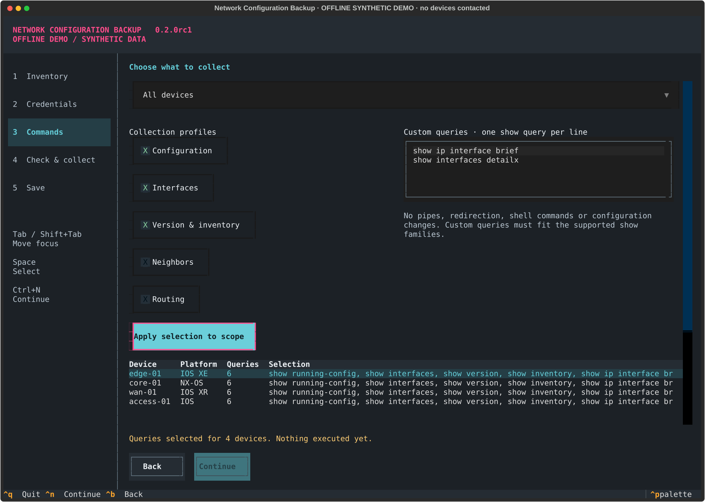
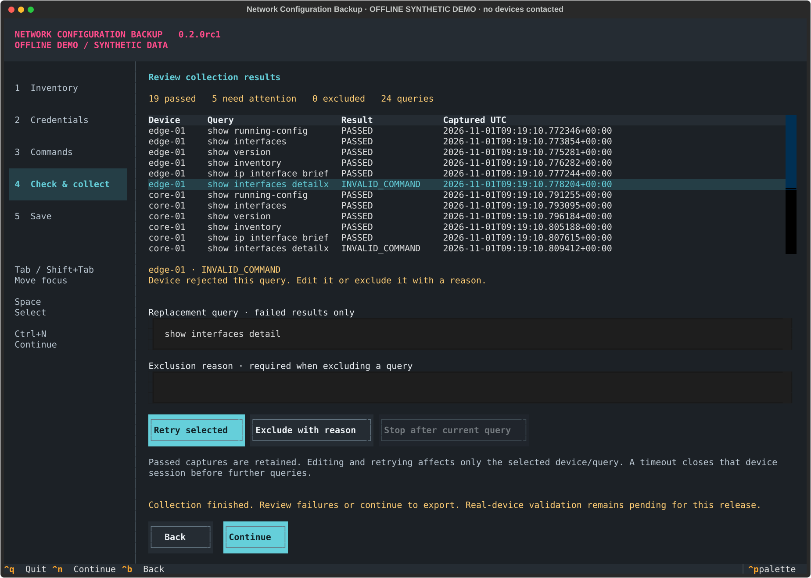
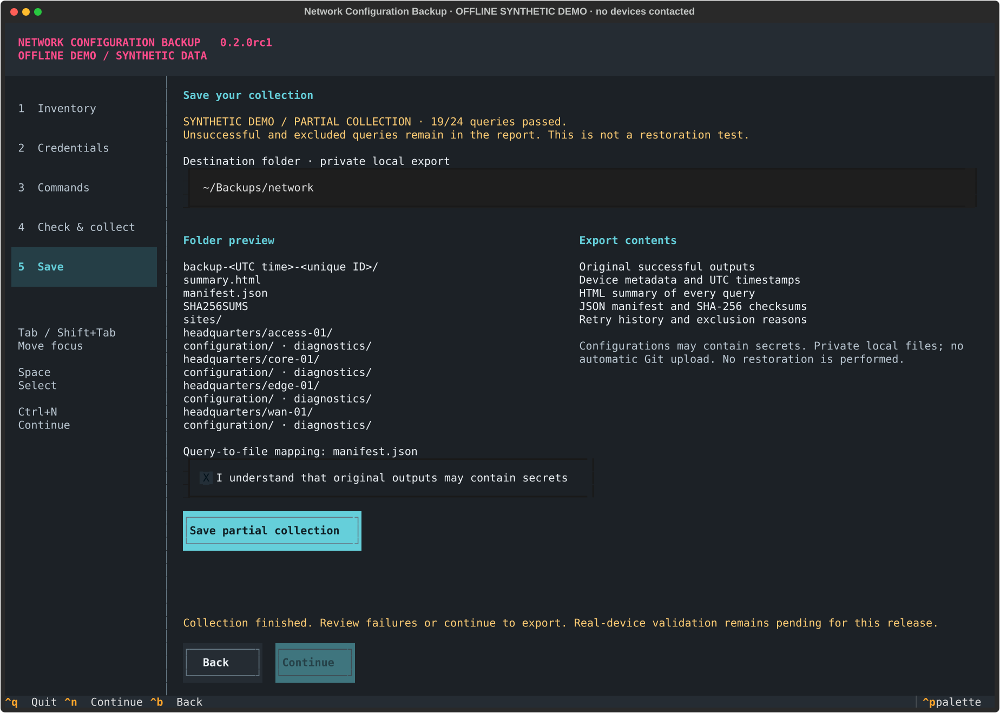

# Network Configuration Backup

A guided terminal assistant for collecting Cisco configurations and diagnostic queries over SSH with Netmiko. Import devices, assign access profiles, select queries by group and platform, correct individual failures, and export a private collection with an auditable report.

**Review preview: 0.2.0rc1. Real-device validation is pending.** The screenshots below come from the actual application using its offline synthetic adapter. They are not evidence of successful Cisco backups. The original project started as a small YAML-to-configuration script; its [original account](docs/original-project-story.md) is preserved.

## Try the assistant

Python 3.11–3.13 on macOS or Linux. Use a dedicated environment:

```bash
git clone https://github.com/carlosalpo/network-config-backup.git
cd network-config-backup
git switch feat/guided-backup-assistant  # review branch
python3 -m venv .venv
source .venv/bin/activate
python -m pip install -e .
ncb --demo
```

`--demo` uses documentation IP addresses and a synthetic adapter that never opens network connections. It deliberately produces a permission failure on `access-01` so you can try a partial export. Add `show interfaces detailx` as a custom query to exercise correction and retry.

For an authorized network, prepare an inventory and independently verified SSH host keys, then run:

```bash
ncb --inventory /path/to/devices.csv
```

No connection occurs until **Check & collect**. Use Tab / Shift+Tab to move, Space to toggle, Ctrl+N to continue, Ctrl+B to go back, and Ctrl+Q to quit. A compact layout supports 80×30 terminals; 150×52 provides room for side-by-side panels. The interface and documentation are in English.

## A collection in five steps

### 1. Inventory

Load CSV, YAML or a text list of IP addresses/hostnames. Alternatively paste hosts and choose their platform. The table previews names, addresses, platforms, groups and sites. Edit your source file and reload before collection; replacing an inventory after collection requires restarting after export.

[Example CSV](examples/devices.csv) · [Original YAML format](inventory.example.yaml)

```csv
name,host,device_type,group,site,port
edge-01,192.0.2.11,cisco_xe,Campus,headquarters,22
core-01,192.0.2.12,cisco_nxos,Datacenter,headquarters,22
wan-01,198.51.100.21,cisco_xr,WAN,headquarters,22
```

`device_type` accepts `cisco_ios`, `cisco_xe`, `cisco_xr`, or `cisco_nxos`. `platform` is an alternative column name. `group`, `site` and `port` are optional (defaults: `default`, `default`, `22`). Platform is declared by the operator, not automatically discovered. Duplicate names/targets, unsafe names, unexpected fields and embedded credentials are rejected.

### 2. Credentials

Use one profile for every device, profiles by inventory group, or individual device profiles. Passwords, SSH-key passphrases and optional enable secrets are masked and kept in memory. Press **Save profile for this session** for every scope. Changing the assignment mode clears saved access profiles.



Unknown or changed SSH host keys are rejected. Select an existing `known_hosts` file containing keys whose fingerprints you verified independently. The assistant does not enroll keys, disable checking, enable SSH, or enable NETCONF. Prefer an account restricted by device AAA to the necessary read commands. An optional enable secret explicitly requests privilege elevation; otherwise no `enable` is attempted.

### 3. Commands

Choose all devices or a group/platform pair. Select Configuration, Interfaces, Version & inventory, Routing, and Neighbors. Add custom consultation queries, one per line. **Apply selection to scope** replaces that scope's planned query list; it does not connect. Each device must have at least one query before collection can start.



Profiles adapt routing queries (`show route` for IOS XR, `show ip route` for the other declared platforms). Availability still depends on device model, software and permissions. See the [command policy and compatibility limits](docs/operations.md).

### 4. Check & collect

The check executes the selected queries and retains successful outputs; it is not a dry run. One SSH session is used per device, processed sequentially. Each query has its own outcome and UTC capture time. Results distinguish invalid/incomplete commands, denied permissions, connection/authentication failures, unknown keys, timeouts, empty or apparently truncated output, and application limits.



Select a failed row, edit its query, and **Retry selected**. Successful captures and their timestamps are retained. Or provide a reason and **Exclude with reason**. Excluded queries remain visible in the report and never make the collection complete. An authentication failure does not trigger retries for every query. A timed-out session is closed before any later query is attempted on that device.

**Stop after current query** requests cooperative cancellation. It waits for the active connection/query timeout; it is not an immediate kill. Starting a new collection requires explicitly acknowledging discard of earlier captures. Export first if you need to keep them.

### 5. Save

Choose a local destination, acknowledge that raw outputs may contain secrets, and save. Unsuccessful queries do not prevent exporting successful ones. The collection is explicitly **partial** unless every planned query passed.



```text
backup-<UTC timestamp>-<unique ID>/
├── summary.html
├── manifest.json
├── SHA256SUMS
└── sites/
    └── headquarters/
        └── edge-01/
            ├── configuration/0001.txt
            └── diagnostics/0002.txt
```

The JSON manifest maps every output file to its device and query, records timestamps, failed attempts and exclusions, and hashes successful outputs. `SHA256SUMS` also covers the manifest and HTML report. A unique export directory prevents overwriting previous backups. On supported POSIX systems directories are private (0700) and files are private (0600). An export failure leaves a hidden `.ncb-incomplete-*` directory for deliberate recovery; it is never presented as a finished backup.

**“Passed” means the query returned to a prompt without a recognized CLI error. “Complete” means all selected queries passed. Neither establishes configuration completeness, device health or successful restoration.** Different queries are captured at different times; this is not a transactional network snapshot.

## Existing script users

`python backup.py` remains available with the original `inventory.yaml`, `NETWORK_USERNAME`, `NETWORK_PASSWORD`, and optional `NETWORK_ENABLE_SECRET`. Install the updated requirements first. Optionally set `NETWORK_KNOWN_HOSTS` to a verified host-key file; otherwise `~/.ssh/known_hosts` is used.

The compatibility entry point now rejects unverified SSH identities and uses the structured private export format above instead of loose `.cfg` files. It still continues after a device failure and returns a nonzero exit code for partial/failing collections. Existing backup files are not rewritten. Prefer the assistant for credentials entered interactively.

## Boundaries and evidence

- Netmiko transport and profiles for IOS, IOS XE, IOS XR and NX-OS; **fresh real-device tests are pending for every platform**.
- Automated coverage includes actual Textual navigation, synthetic adapters, failure injection, export integrity/permissions, and real Netmiko exchanges against a loopback Paramiko protocol fixture. That fixture is not a Cisco device emulator or interoperability certification.
- No scheduled jobs, secrets vault, automatic Git upload, restore, configuration changes, distributed collectors or NETCONF implementation in this preview.
- No raw outputs, inventories or access credentials are uploaded by the application. Backups can contain device secrets; keep them out of Git and use appropriate encrypted storage. Checksums detect changes relative to a trusted manifest; they are not signatures or encryption.
- Maximum 100 devices, 50 queries/device, 1 MB inventory, 8 MiB retained output/query and 64 MiB retained output/collection. Output limits are checked **after Netmiko returns**, so they do not bound transport-time memory use. Keep expensive queries out of the plan.

[Operations and security](docs/operations.md) · [Automated validation](docs/validation.md) · [Screenshot provenance](docs/screenshots/README.md)

## Development

```bash
python -m pip install -e '.[dev]'
python -m pytest -q
ruff check src tests scripts backup.py
ruff format --check src tests scripts backup.py
python -m build
python scripts/capture.py
```

Tests prohibit external socket connections; SSH integration fixtures bind only to loopback. CI runs on Python 3.11, 3.12 and 3.13. Real-device testing is a separate, owner-controlled step.
